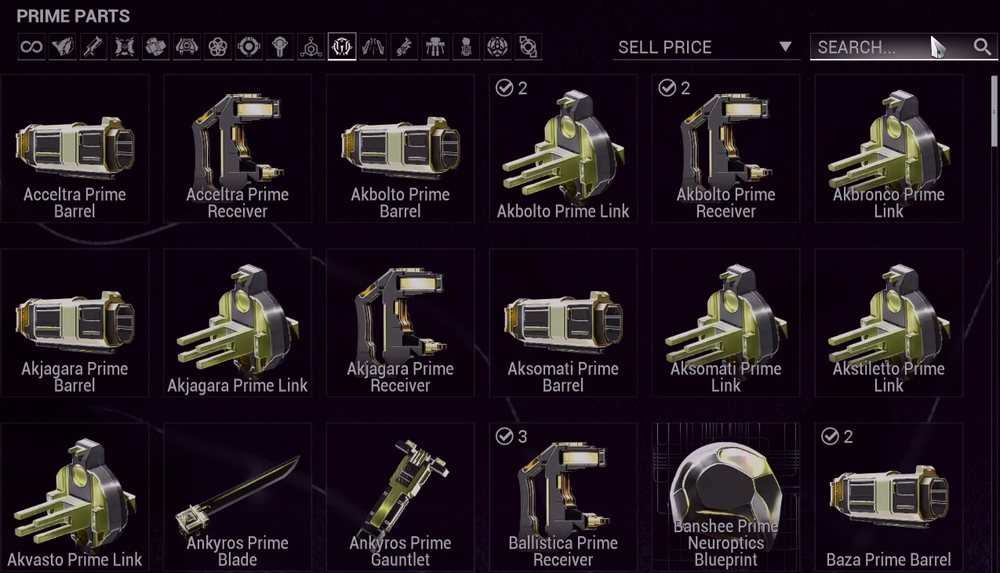
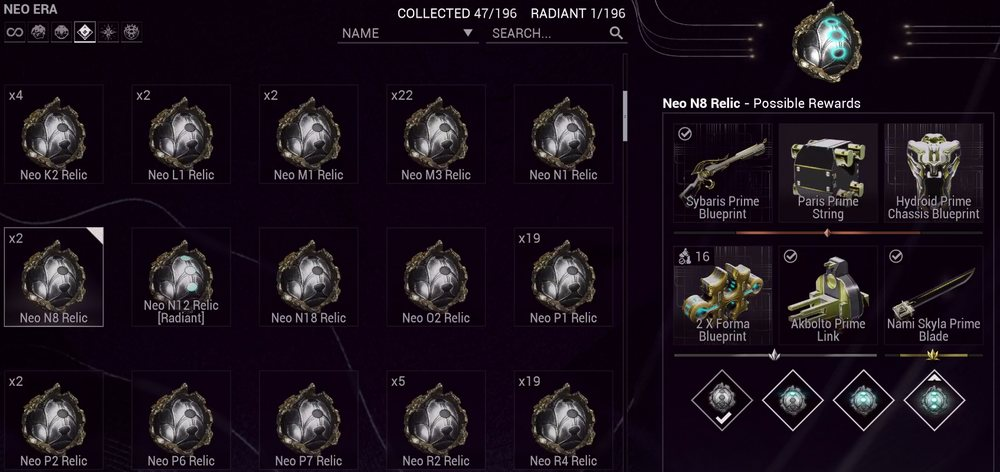
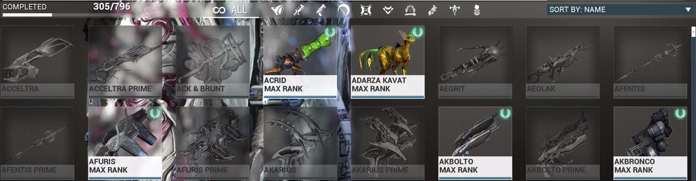

# Loki's Vault

A Warframe planner for players who cannot run overlays. Track the relics and prime parts you own, plan the prime sets you want, tick off mastery, and decide which spare parts to sell for platinum or trade to Baro Ki'Teer for ducats.

**Live site: https://dpaess.github.io/LokisVault/**

## Why

I play Warframe through GeForce Now. The game runs in the cloud, so tools like AlecaFrame, WFInfo or WFIT cannot see my inventory. Loki's Vault is the low-tech answer: you type in what you own, paste a list or drop in screenshots, and the site does the planning with public game data and market prices.

## Features

* **Overview**: mastery progress, wishlist completion, relic count, the value of your spare parts in plat and ducats, and next steps: which relics to crack (click one to see its drops with your wishlist parts highlighted) and which needed parts you have no relic for (click one to see where to farm or buy it).
* **Relics**: your relics by refinement (intact, exceptional, flawless, radiant), their rewards with drop chance, price and ducats, parts you still need highlighted, and the expected value of one opening. Relics are tagged as dropping now or vaulted, and can be filtered by type (Lith, Meso, Neo, Axi, Requiem).
* **Prime parts**: the parts you own, how many your wishlist needs, and which sets you can build right now.
* **Wishlist**: prime sets you want. Each missing part shows which of your relics drop it, which relics you can farm today, or a warframe.market link when every source is vaulted. Mark a set as built to use up its parts and mark it mastered. Search, filter (category, ready or missing parts, vaulted, missing parts in my relics) and sort (closest to done, fewest missing, set price).
* **Mastery**: every masterable item with mastered or not, remaining mastery points, filters and bulk marking for a quick first fill.
* **Sell or ducat**: every spare part with its market price, ducat value and a verdict based on a ducats per plat threshold you choose, plus spare sets worth more sold whole.
* **Data**: add relics, prime parts and mastered items from screenshots (see below), JSON backup and restore, optional sync between devices through a secret Gist on your own GitHub account, and bulk paste for relics, parts and mastered items (`3x Lith G1`, `Neo H4 Relic (Radiant) x2`, `Loki Prime Chassis`...).

## Adding items from screenshots

Typing hundreds of items is slow, so the Data tab can read them from screenshots you take in game. With GeForce Now, the overlay screenshot or your system's screenshot key both work. Choose, drop or paste one or many screenshots, check the list it finds, then click **Add checked to vault**. Text recognition runs in your browser with Tesseract.js and your images are never uploaded.

Three screens work today:

**Inventory → Prime Parts.** Names and the ✓ count in each tile's corner are read. A tile without a number counts as one.



**Void Relics.** The relic name, the `x22` style count and the refinement (`[Radiant]`) are read. The "Possible Rewards" panel on the right is ignored, those are not items you own. Take one screenshot per era tab.



**Profile → Equipment.** Every tile showing **MAX RANK** is marked as mastered. Tiles still levelling (`RANK 28`) and greyed out items are skipped, and nothing is ever unmarked.



Tips: scroll and keep taking screenshots, overlap is fine because an item seen twice counts once. Each screenshot is read in four passes, so allow a few seconds per image. Always glance over the review table, recognition is good but not perfect.

<sub>Screenshots of Warframe © Digital Extremes Ltd., cropped to the item grid and used non-commercially under the [Warframe Content Policy](https://www.warframe.com/contentpolicy).</sub>

## Privacy

Your inventory is stored in your browser (`localStorage`). Nothing is sent anywhere unless you turn on sync.

**Optional sync.** In Data → Sync between devices you can paste a GitHub token that only has the `gist` permission. The site then keeps your vault in a secret Gist on your own account (`lokisvault.json`) and talks only to `api.github.com`. The newest copy wins, and the copy it replaced stays restorable in that browser. The token is stored only in that browser and is never part of an exported backup. Secret Gists are unlisted, not encrypted, so anyone with the exact link could read your inventory. Screenshots you import are read on your device by [Tesseract.js](https://github.com/naptha/tesseract.js) and never uploaded (only the engine and its English model are downloaded from jsDelivr the first time). Use **Data → Export JSON** to keep a backup or move to another device.

## Is this safe with DE's terms?

Yes. The site never touches the game: no memory reading, no screen capture, no automation. The screenshot import only reads image files you saved and chose yourself, after the fact, the same way you would type the names by hand. It uses public community data, and market prices are fetched once a day by a GitHub Action that stays under warframe.market's rate limit.

## Data sources

* [WFCD/warframe-items](https://github.com/WFCD/warframe-items) (`@wfcd/items`): masterable items, prime sets, components and ducats.
* [WFCD/warframe-drop-data](https://github.com/WFCD/warframe-drop-data): relic reward tables and current mission drops, from DE's official drop tables.
* [Tesseract.js](https://github.com/naptha/tesseract.js): in browser text recognition for the screenshot import.
* [warframe.market](https://warframe.market) API: live sell and buy orders. A price is the median of the five cheapest sellers who are online or in game.

Thanks to the Warframe Community Developers and the warframe.market team.

## Run locally

Requires Node 18 or newer.

```sh
npm ci
npm run build:data     # writes public/data/items.json
npm run fetch:prices   # writes public/data/prices.json, takes about 10 minutes
npm run serve          # http://localhost:8080
```

`npm run fetch:prices -- --limit 20` fetches only the first 20 items, handy for testing.

The GitHub Action in `.github/workflows/update-and-deploy.yml` rebuilds the data every day, commits it when it changed, and deploys `public/` to GitHub Pages.

## Known gaps

* Amps, some MOA and Hound parts, Plexus, intrinsics and the star chart are not counted for mastery.
* Relics only available through Prime Resurgence (Varzia) are not in mission drop tables, so they show as vaulted.
* Prices refresh once a day, so they lag the live market a little.

## License

[MIT](LICENSE). Fan made and not affiliated with or endorsed by Digital Extremes. Warframe and all related names are trademarks of Digital Extremes Ltd.
